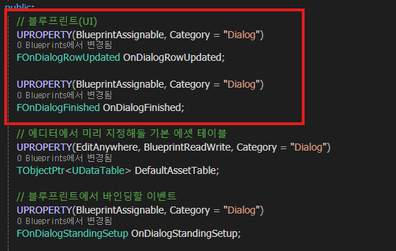

# Chronoclasm (크로노클라즘)

**Unreal Engine 5.5 · C++ / Blueprint / GAS · 3D 턴제 로그라이트 RPG**

시간의 신이 인간으로 추방된 뒤, 시간을 조작하며 다시 신의 자리를 되찾아가는 다크 판타지 게임입니다.  
무기 선택과 패링, 유물·오파츠의 효과를 활용해 전투를 진행합니다.

  
  
  

전투 플레이 · 유물 선택 · 대화 시스템 — 포트폴리오 PPT에 사용한 실제 게임 화면

## 프로젝트 개요

| 항목 | 내용 |
| :--- | :--- |
| **개발 기간** | **2025.08 ~ 2026.09** |
| 개발 방식 | 기획 2명 · 프로그래머 2명, 총 4인 팀 프로젝트 |
| 개발 환경 | Unreal Engine 5.5 / C++ / Blueprint / Gameplay Ability System(GAS) / Gameplay Tag |
| 주요 담당 | 유물·오파츠 관련 플레이어 어빌리티, 보상 UI, 대화·상호작용, 플레이어 스탯 |
| 공동 작업 | **세이브 시스템** — 다른 프로그래머와 함께 구현. 이 문서에서는 **플레이어 스탯 저장 및 복원 연동**을 중심으로 설명 |
| 코드 | [Project_SP / RealSeoungMin 브랜치](https://github.com/ByeonghyunChoi/Project_SP/tree/RealSeoungMin) |

> **내 담당 범위**  
> 턴 진행과 전투 코어, 패링 판정 등은 다른 프로그래머가 담당했습니다. 저는 그 전투 시스템과 연결되는 플레이어 어빌리티, UI와 성장·데이터 처리 부분을 주로 맡았습니다.

### 빠르게 보는 담당 업무

| 영역 | 직접 작업한 내용 |
| :--- | :--- |
| **유물·오파츠** | Gameplay Tag 이벤트를 받아 효과를 실행하는 플레이어 어빌리티 구현 |
| **보상 UI** | 보상 데이터 준비와 획득 팝업 갱신 순서 수정 |
| **대화 시스템** | 데이터 테이블 기반 대화, 누락 이미지 처리, 연속 스킵 입력 방어 |
| **플레이어 스탯 / 저장 연동** | 영구 강화 스탯의 저장·복원 처리와 GAS AttributeSet 반영 |

---

## 구현 및 문제 해결

### 01. 유물·오파츠 — 전투 코드와 이벤트로 연결

**왜 나눴나**

처음부터 모든 유물 기능을 전투 코드에 직접 추가하면, 유물이 늘어날 때마다 다른 프로그래머가 담당한 영역을 함께 수정해야 했습니다. 실제 팀 작업에서는 Git 병합과 수정 범위가 겹치는 부분도 고려해야 했습니다.

**어떻게 구현했나**

전투 쪽에서는 행동이 발생했다는 **Gameplay Tag 이벤트**를 전달하고, 유물·오파츠 어빌리티에서는 `AbilityTask_WaitGameplayEvent`로 필요한 이벤트를 기다리도록 구성했습니다.

<b>실제 이벤트 송출·수신 코드 캡처 보기</b>

 

  
  

왼쪽: 이벤트 송출 · 오른쪽: 이벤트 수신 — PPT 9페이지에서 발췌

**바뀐 점**  
새 유물의 발동 조건을 전투 코드에 계속 추가하기보다, 유물이 필요한 태그를 수신하고 자기 효과를 실행하도록 분리했습니다.

### 02. 보상 UI — 데이터와 팝업의 호출 순서 맞추기

**발생한 문제**

상자를 열었을 때 재화는 정상적으로 들어오는데 **획득 팝업이 비거나 이전 데이터가 표시**되는 문제가 있었습니다.

기존에는 인벤토리 변경 알림에 따라 UI가 데이터를 확인했습니다. 그런데 보상 큐가 갱신되기 전에 UI가 먼저 읽는 경우가 있었습니다.

**수정한 방식**

보상 큐를 초기화하고 최신 데이터를 설정한 **다음**, 보상 UI 전용 델리게이트를 `Broadcast`하도록 호출 순서를 수정했습니다.

<b>보상 UI 관련 실제 코드 캡처 보기</b>

 

**바뀐 점**  
팝업은 보상 데이터가 준비된 뒤에 갱신되도록 순서를 맞췄습니다.

### 03. 대화 시스템 — 누락 데이터와 반복 입력 처리

대화 데이터 테이블에서 내용을 읽어오고, 화자 이미지와 대사 내용을 UI에 표시하는 기능을 구현했습니다. 개발 중에는 다음 문제들을 확인했습니다.

| 문제 | 수정한 부분 |
| :--- | :--- |
| NPC 일러스트가 없는 대화에서 `nullptr` 크래시 발생 | 이미지 유효성을 검사하고, 누락 시 빈 이미지로 처리 |
| 첫 화자 이미지가 늦게 표시됨 | 대화 시작 전에 사용할 이미지 에셋을 먼저 찾도록 수정 |
| 스킵 버튼을 연속 입력할 때 타이머·사운드 중복 | `Timer Handle`을 이용해 중복 실행을 제어 |

<b>대화 이미지 조회·블루프린트 연동 코드 캡처 보기</b>

 

  
  

대화 이미지 조회 처리 · 블루프린트에서 사용하는 함수 선언 — PPT 13페이지에서 발췌

**바뀐 점**  
이미지가 없는 대사와 빠른 연속 입력처럼 실제 게임에서 발생할 수 있는 상황을 따로 확인하고 처리했습니다.

### 04. 플레이어 스탯 — 공동 세이브 시스템과 연동

**공동 작업과 내 담당 부분을 구분했습니다.**

세이브 시스템은 다른 프로그래머와 함께 작업했습니다. 게임에서 **사망하면 지워야 할 진행 데이터**와 **사망 후에도 유지할 영구 강화 데이터**를 구분해야 했습니다.

저는 이 과정에서 **플레이어 스탯 저장·복원에 관련된 부분**을 맡아, 영구 강화 데이터를 캐릭터 재생성 후 GAS `AttributeSet`에 반영하도록 연결했습니다.

| 구분 | 역할 |
| :--- | :--- |
| **`Slot_Run`** | 현재 진행 중인 플레이 데이터. 사망 시 초기화 |
| **`Slot_Perm`** | 영구 강화 등 사망 이후에도 유지할 데이터 |
| **플레이어 스탯 연동 (내 담당)** | 영구 데이터 저장·로드 및 캐릭터 재생성 후 기본 스탯 적용 |

**바뀐 점**  
진행 데이터의 초기화와 영구 강화 스탯의 복원을 구분해, 맵 이동이나 캐릭터 재생성 이후에도 필요한 성장 데이터를 다시 적용하도록 했습니다.

---

## 프로젝트 개발 흐름

| 시기 | 진행 내용 |
| :--- | :--- |
| **2025.08** | 실시간 RPG 방향으로 초기 개발 시작 |
| **2025.12** | 기존 프로젝트를 바탕으로 턴제 로그라이트 RPG로 기획 개편 |
| **2026.06** | 주요 콘텐츠와 시스템 구현 완료, 통합 및 QA 진행 |
| **2026.09** | 전시를 준비하며 버그 수정, 이미지 리소스 교체, 최적화 보완 |

2025년 12월의 기획 변경 이후에는 같은 팀원들과 기존 작업을 이어가면서, 바뀐 전투 방식에 맞춰 각자 담당한 시스템을 수정하고 연결했습니다.

---

## 코드 확인

**[GitHub — RealSeoungMin 브랜치 열기](https://github.com/ByeonghyunChoi/Project_SP/tree/RealSeoungMin)**

이 README는 제가 맡은 영역을 중심으로 설명한 포트폴리오 문서입니다.  
실제 게임 프로젝트와 소스는 팀 저장소에 있으며, 이 문서에 포함된 게임 화면과 코드 캡처는 제출용 PPT에서 가져왔습니다.

> **참고:** 도식은 흐름을 이해하기 쉽게 정리한 설명용 이미지입니다. 클래스와 함수의 정확한 위치를 안내하는 링크는 저장소의 최종 소스 구조를 확인한 후 추가하는 것이 좋습니다.
