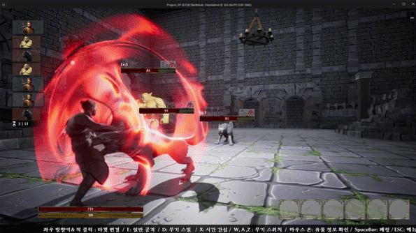
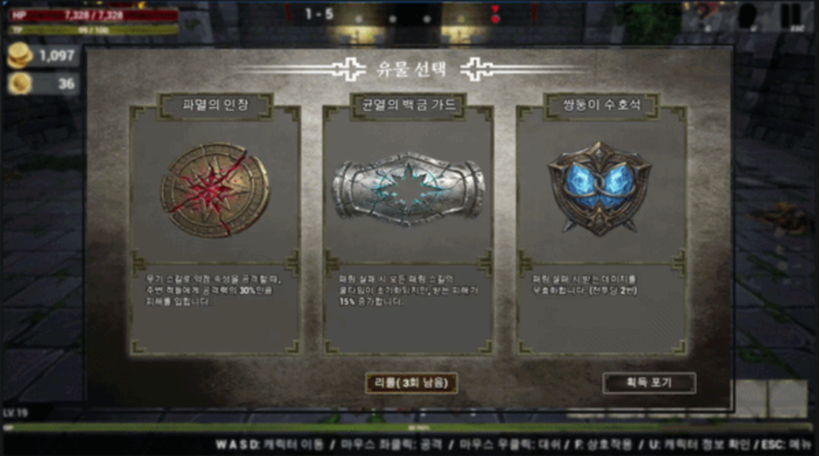
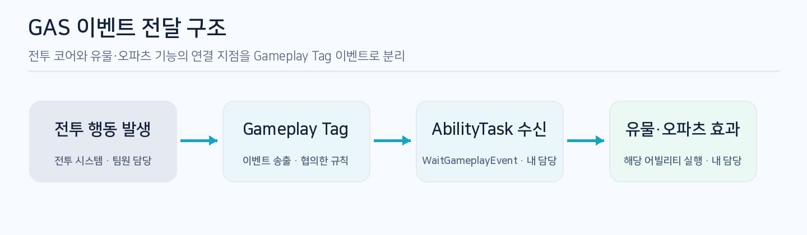
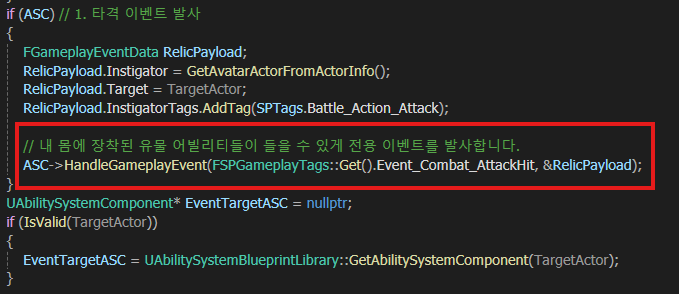
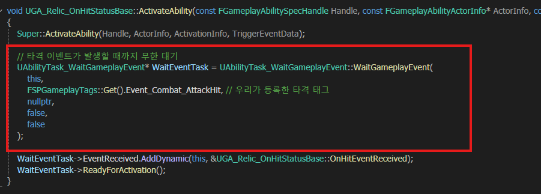
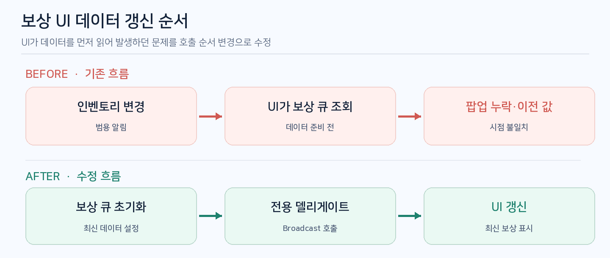
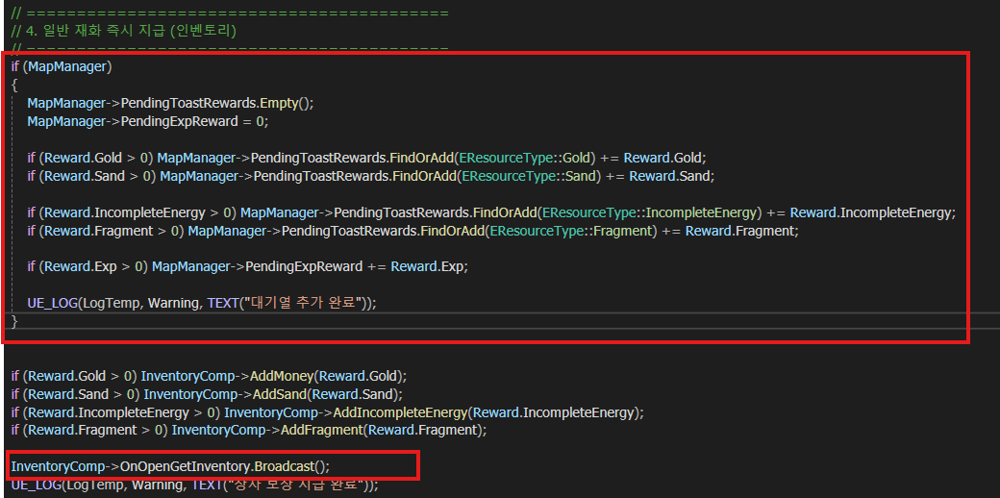
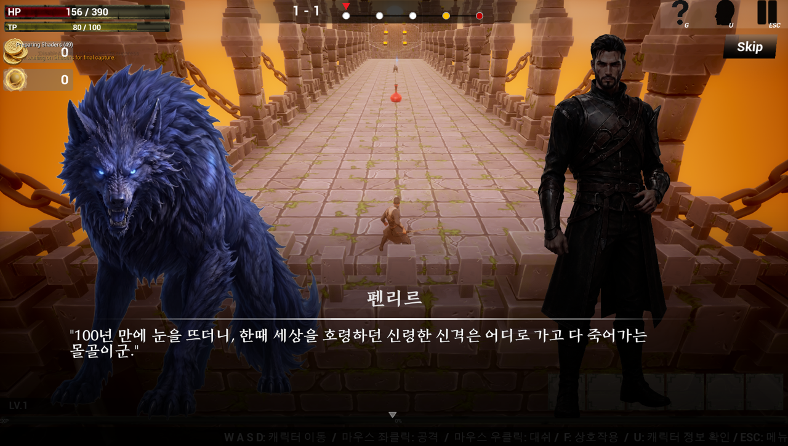
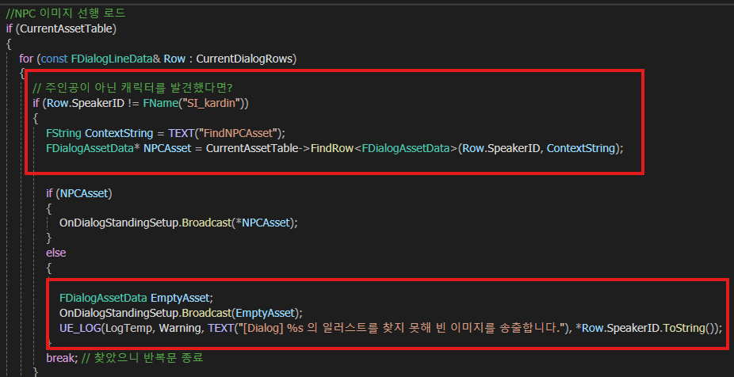
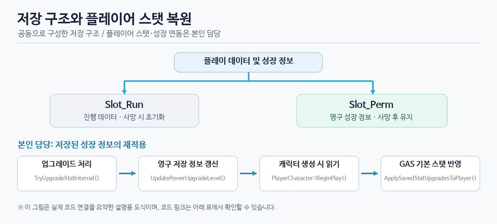

# Chronoclasm · 크로노클라즘

**Unreal Engine 5.5 · C++ / Blueprint / Gameplay Ability System · 3D 턴제 로그라이트 RPG**

시간의 신이 인간으로 추방된 뒤 다시 신의 자리를 되찾아가는 다크 판타지 게임입니다.  
무기 선택과 패링, 유물·오파츠 효과를 조합하며 스테이지를 진행합니다.

  
  

실제 플레이 장면 — 전투 / 스테이지 클리어 후 유물 선택

## 프로젝트 정보

| 구분 | 내용 |
| --- | --- |
| 개발 기간 | **2025.08 ~ 2026.09** |
| 구성 | 4인 팀 프로젝트 · 기획 2명, 프로그래머 2명 |
| 개발 환경 | Unreal Engine 5.5 · C++ · Blueprint · GAS · Gameplay Tag |
| 주요 담당 | **유물·오파츠 어빌리티, 보상 UI, 대화 시스템, 플레이어 성장·스탯** |
| 공동 작업 | **세이브 시스템** — 이 문서에서는 특히 플레이어 스탯 저장·복원 연동을 설명 |
| 플레이 영상 | [팀 프로젝트 플레이 영상](https://youtu.be/pEEvE2xtDd0) |

> **담당 범위 안내**  
> 턴 순서 관리·전투 코어·패링 판정의 주요 구현은 다른 프로그래머가 맡았습니다.  
> 저는 해당 시스템과 연결되는 **유물·오파츠 효과, 비전투 UI, 대화, 플레이어 스탯·성장**에 집중했습니다. 아래에 표기한 전투 이벤트 *송출 코드*는 연동 방식을 이해하기 위한 **팀원 담당 코드**로 구분했습니다.

## 이 문서에서 확인할 수 있는 내용

| 기능 | 실제로 다룬 내용 | 코드 바로 가기 |
| --- | --- | --- |
| 유물·오파츠 | Gameplay Tag 이벤트를 기다렸다가 플레이어 어빌리티 효과 발동 | [유물 이벤트 수신](Source/Project_SP/Private/GA/Relic/GA_Relic_OnHitStatusBase.cpp#L17-L32) |
| 보상 UI | 보상 데이터 준비 후 전용 알림 호출, 팝업 데이터 타이밍 수정 | [보상 상자 처리](Source/Project_SP/Private/Map/RewardBox.cpp#L60-L85) |
| 대화 | 데이터 테이블 조회, 없는 NPC 일러스트를 빈 데이터로 처리 | [대화 에셋 조회](Source/Project_SP/Private/SubSystem/SPDialogSubsystem.cpp#L68-L97) |
| 플레이어 스탯 | 영구 강화 레벨 저장과 새 캐릭터 생성 시 GAS 스탯에 재적용 | [영구 스탯 적용](Source/Project_SP/Private/SubSystem/SPPowerUpgradeSubsystem.cpp#L348-L383) |

---

## 01 · 유물·오파츠 — 전투 시스템과 이벤트로 연결

### 왜 이 방식을 선택했나

유물 효과를 전투 코드 안에 직접 추가하면 기능이 늘어날 때마다 다른 프로그래머의 담당 파일도 수정해야 했습니다. 실제 협업 중 작업 범위가 겹칠 수 있어서, **전투 쪽은 행동 이벤트를 알리고 유물 어빌리티가 필요한 이벤트만 받는 방식**으로 나눴습니다.

### 실제 구현

- 전투 행동 쪽에서 Gameplay Tag 이벤트를 발생시킵니다. *(전투 시스템 연동부 — 다른 프로그래머의 담당 영역)*
- 유물 어빌리티는 `AbilityTask_WaitGameplayEvent`로 필요한 태그를 수신하고, 콜백에서 효과를 실행합니다.
- 예를 들어 일반 공격 적중을 기다리는 유물과 패링 성공을 기다리는 유물이 서로 다른 이벤트를 구독합니다.

  
  

왼쪽: 전투 이벤트 송출(팀원 연동부) / 오른쪽: 유물 어빌리티 이벤트 수신

**관련 클래스 / 코드**

| 구분 | 실제 코드 | 확인할 부분 |
| --- | --- | --- |
| 연동 · 팀원 코드 | [`SPGA_BattleActionBase.cpp` 324–333행](Source/Project_SP/Private/GA/SPGA_BattleActionBase.cpp#L324-L333) | 일반 공격 적중 이벤트 송출 |
| 유물 · 이벤트 대기 | [`GA_Relic_OnHitStatusBase.cpp` 17–32행](Source/Project_SP/Private/GA/Relic/GA_Relic_OnHitStatusBase.cpp#L17-L32) | `WaitGameplayEvent` 등록 / 콜백 연결 |
| 유물 · 효과 적용 | [`GA_Relic_OnHitStatusBase.cpp` 46–71행](Source/Project_SP/Private/GA/Relic/GA_Relic_OnHitStatusBase.cpp#L46-L71) | 태그·확률 검사 후 GE 적용 |
| 유물 · 패링 이벤트 | [`GA_Relic_BentIron.cpp` 23–50행](Source/Project_SP/Private/GA/Relic/GA_Relic_BentIron.cpp#L23-L50) | 패링 성공 수신 후 BP 회복 GE |
| 오파츠 · 이벤트 대기 | [`GA_Oparts_CrystalSkull.cpp` 17–32행](Source/Project_SP/Private/GA/OpartsAbility/GA_Oparts_CrystalSkull.cpp#L17-L32) | 치명타 이벤트를 기다리는 처리 |
| 장착 · 능력 부여 | [`OpartsComponent.cpp` 208–300행](Source/Project_SP/Private/Component/OpartsComponent.cpp#L208-L300) | 오파츠 스탯·GA/GE 적용과 갱신 |

**정리**  
유물마다 필요한 이벤트와 발동 효과를 담당하도록 분리했습니다. 모든 유물 조건을 전투 코어에 직접 추가하는 대신, 팀원과 정한 이벤트 규칙을 통해 연결했습니다.

---

## 02 · 보상 UI — 데이터가 준비된 뒤 팝업 열기

### 발생한 문제

보상을 정상적으로 획득했는데도 획득 팝업이 비거나 이전 보상이 표시되는 문제가 있었습니다. **UI가 조회하는 보상 데이터의 갱신 시점과 알림을 호출하는 순서**를 확인했습니다.

### 수정한 방식

상자 상호작용 처리에서 보상 대기열을 초기화하고 이번 보상 데이터로 채운 다음, 인벤토리에 재화를 반영하고 `OnOpenGetInventory` 알림을 발생시키도록 정리했습니다.

이 변경은 실제 `RewardBox.cpp`에서 **대기열 갱신(64–74행) → 재화 지급(79–82행) → 알림 방송(84행)** 순서로 확인할 수 있습니다.

**관련 클래스 / 코드**

| 실제 코드 | 확인할 부분 |
| --- | --- |
| [`RewardBox.cpp` 60–85행](Source/Project_SP/Private/Map/RewardBox.cpp#L60-L85) | 보상 큐 설정 후 `OnOpenGetInventory.Broadcast()` 호출 |
| [`InventoryComponent.h` 21–51행](Source/Project_SP/Public/Component/InventoryComponent.h#L21-L51) | 인벤토리 갱신 알림과 보상 UI 전용 알림의 선언 |
| [`InventoryComponent.cpp` 111–120행](Source/Project_SP/Private/Component/InventoryComponent.cpp#L111-L120) | 골드 변경과 일반 인벤토리 알림 |

**정리**  
보상 데이터가 준비되기 전에 팝업이 먼저 데이터를 읽는 상황을 줄이도록 **데이터 설정과 UI 알림의 순서**를 수정했습니다.

> 팝업 위젯에서 `OnOpenGetInventory`를 **수신하는 Blueprint 바인딩**은 이번 C++ `Source` ZIP만으로는 확인할 수 없습니다. 따라서 위 표에는 C++에서 확인되는 코드만 연결했습니다.

---

## 03 · 대화 시스템 — 없는 일러스트도 처리하기

대화는 데이터 테이블에서 대사를 읽고, 화자 정보에 맞춰 이미지와 텍스트를 보여주는 방식으로 구현했습니다.

개발 중 NPC 이미지가 등록되지 않은 대사에서 잘못된 객체에 접근하는 문제가 있었고, **테이블 조회 결과가 없을 때 빈 데이터로 알림을 보내는 처리**를 추가했습니다. 대화가 시작될 때 필요한 NPC 이미지 데이터를 먼저 찾아보는 흐름도 넣었습니다.

  

실제 대화 UI

**관련 클래스 / 코드**

| 실제 코드 | 확인할 부분 |
| --- | --- |
| [`SPDialogSubsystem.cpp` 8–34행](Source/Project_SP/Private/SubSystem/SPDialogSubsystem.cpp#L8-L34) | 대화 테이블의 행을 읽어 배열에 보관 |
| [`SPDialogSubsystem.cpp` 68–97행](Source/Project_SP/Private/SubSystem/SPDialogSubsystem.cpp#L68-L97) | 대화 시작 전 NPC 이미지 조회, 누락 시 `EmptyAsset` 전달 |
| [`SPDialogSubsystem.cpp` 102–126행](Source/Project_SP/Private/SubSystem/SPDialogSubsystem.cpp#L102-L126) | 대사별 에셋 조회 및 `OnDialogRowUpdated.Broadcast()` |
| [`SPDialogSubsystem.h` 9–52행](Source/Project_SP/Public/SubSystem/SPDialogSubsystem.h#L9-L52) | 대화 갱신·일러스트 설정 델리게이트와 BP 연동 인터페이스 |

**정리**  
일러스트가 항상 있다는 전제 대신, 없는 데이터를 받았을 때도 **대화 정보를 전달할 수 있도록** 수정했습니다.

> 스킵 버튼 연타와 `Timer Handle` 처리는 포트폴리오에서 다뤘지만 이번 C++ ZIP에서는 관련 구현을 확인하지 못했습니다. 해당 부분은 실제 Blueprint를 확인한 뒤 별도 문서에 추가할 예정입니다.

---

## 04 · 플레이어 스탯 — 공동 세이브 시스템과 연결

**세이브 시스템 전체를 혼자 만든 것은 아닙니다.** 다른 프로그래머와 함께 저장 구조를 구성했고, 저는 그중에서도 **플레이어의 스탯·성장 데이터를 저장하고 게임에서 다시 적용하는 부분**을 중심으로 작업했습니다.

### 저장과 복원은 어디에서 이루어지나

- **공동 저장 구조:** `Slot_Run`에는 진행 중인 데이터가, `Slot_Perm`에는 유지해야 하는 영구 데이터가 저장됩니다. 사망 시에는 런 데이터를 초기화합니다.
- **업그레이드 저장:** 스탯 업그레이드 시 변경된 강화 레벨을 영구 저장 데이터에 기록합니다.
- **스탯 재적용:** 새로운 캐릭터가 생성되면 저장된 업그레이드 레벨을 기준으로 GAS의 기본 스탯에 다시 보너스를 반영합니다.
- **현재 스탯 복원:** 별도로 체력·경험치 등 현재 상태를 `AttributeSet`에 복원하는 코드도 있습니다.

**관련 클래스 / 코드**

| 구분 | 실제 코드 | 확인할 부분 |
| --- | --- | --- |
| 공동 저장 구조 | [`SPSaveGameSubsystem.h` 99–111행](Source/Project_SP/Public/SubSystem/SPSaveGameSubsystem.h#L99-L111) | `Slot_Run` / `Slot_Perm` 이름 |
| 공동 저장 구조 | [`SPSaveGameSubsystem.cpp` 120–127행](Source/Project_SP/Private/SubSystem/SPSaveGameSubsystem.cpp#L120-L127) | 런 데이터 초기화 |
| 스탯 데이터 기록 | [`SPSaveGameSubsystem.cpp` 130–164행](Source/Project_SP/Private/SubSystem/SPSaveGameSubsystem.cpp#L130-L164) | 플레이어 GAS 스탯 값을 `PermData.Stats`에 보관 |
| 강화 레벨 저장 | [`SPSaveGameSubsystem.cpp` 214–220행](Source/Project_SP/Private/SubSystem/SPSaveGameSubsystem.cpp#L214-L220) | 강화 레벨 갱신 및 영구 슬롯 저장 호출 |
| 성장 처리 | [`SPPowerUpgradeSubsystem.cpp` 221–294행](Source/Project_SP/Private/SubSystem/SPPowerUpgradeSubsystem.cpp#L221-L294) | 스탯 업그레이드 비용·레벨·GAS 반영 |
| 저장된 성장 재적용 | [`SPPowerUpgradeSubsystem.cpp` 348–383행](Source/Project_SP/Private/SubSystem/SPPowerUpgradeSubsystem.cpp#L348-L383) | 영구 강화 레벨을 읽어 `SetNumericAttributeBase` 적용 |
| 캐릭터 생성 시점 | [`SPGASPlayerCharacter.cpp` 195–205행](Source/Project_SP/Private/Character/SPGASPlayerCharacter.cpp#L195-L205) | `BeginPlay()`에서 저장된 영구 스탯 보너스 적용 |
| 현재 상태 복원 | [`SPSaveGameSubsystem.cpp` 64–101행](Source/Project_SP/Private/SubSystem/SPSaveGameSubsystem.cpp#L64-L101) | 경험치·체력·타임파워 등 GAS 상태 복원 |

**정리**  
캐릭터가 새로 생성되더라도 영구 강화 레벨을 읽어 **GAS 스탯을 다시 적용**하도록 연결했습니다. 저장 슬롯 전체의 구현과 플레이어 스탯 연동의 담당 범위를 구분해 설명했습니다.

---

## 개발 과정

| 시기 | 진행 내용 |
| --- | --- |
| 2025.08 | 실시간 RPG 방향으로 초기 개발 |
| 2025.12 | 기존 프로젝트를 바탕으로 턴제 로그라이트 RPG로 개편 |
| 2026.06 | 주요 게임 시스템과 콘텐츠 개발 마무리 |
| 2026.09 | 전시를 위한 버그 수정, 리소스 교체 및 최적화 보완 |

---

## 마무리

이 문서는 Chronoclasm 프로젝트에서 문성민이 담당한 시스템의 구현 과정과 문제 해결 내용을 정리한 포트폴리오용 README입니다.

각 시스템의 설계 의도와 주요 코드, 실제 게임 화면을 함께 정리했으며, 자세한 구현 내용은 연결된 소스 코드에서 확인할 수 있습니다.
